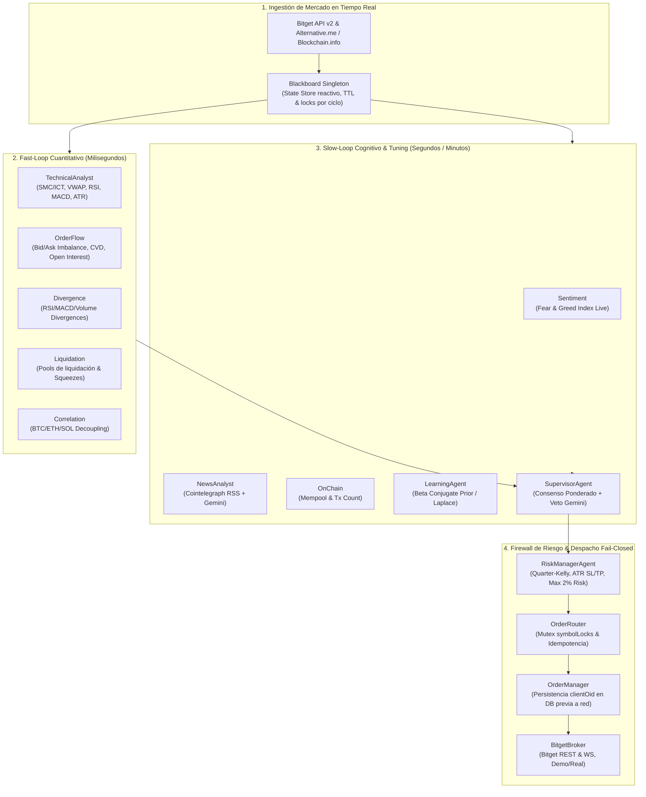

# 🛡️ INFORME DE AUDITORÍA TÉCNICA Y FORENSE — ATLAS AI TRADING v2.0.0

**Proyecto:** [Atlas-AI-Trading](https://github.com/jsoto-06/Atlas-AI-Trading)  
**Fecha:** 14 de Noviembre de 2026  
**Auditor:** Antigravity AI — Institutional Code & Quantitative Auditor  
**Veredicto General:** `🟡 READY FOR PAPER / BITGET DEMO` (Apto para simulación y pruebas en Bitget Demo, sujeto a remediación de hallazgos críticos antes de capital real).

---

## 📑 Tabla de Contenidos

1. [Resumen Ejecutivo y Veredicto Global](#1-resumen-ejecutivo-y-veredicto-global)
2. [Arquitectura del Sistema (Patrón Blackboard)](#2-arquitectura-del-sistema-patrón-blackboard)
3. [Auditoría Detallada por Componentes](#3-auditoría-detallada-por-componentes)
   - 3.1. [Agentes Analistas Especialistas](#31-agentes-analistas-especialistas)
   - 3.2. [Motor de Aprendizaje Bayesiano (`LearningAgent`)](#32-motor-de-aprendizaje-bayesiano-learningagent)
   - 3.3. [Firewall de Riesgo Cuantitativo (`RiskManagerAgent`)](#33-firewall-de-riesgo-cuantitativo-riskmanageragent)
   - 3.4. [Orquestación de Consenso (`SupervisorAgent`)](#34-orquestación-de-consenso-supervisoragent)
   - 3.5. [Motor de Ejecución e Idempotencia (`OrderManager` & `BitgetBroker`)](#35-motor-de-ejecución-e-idempotencia-ordermanager--bitgetbroker)
   - 3.6. [Motor de Backtesting Walk-Forward](#36-motor-de-backtesting-walk-forward)
   - 3.7. [Capa de Persistencia y Seguridad REST](#37-capa-de-persistencia-y-seguridad-rest)
4. [Matriz de Vulnerabilidades y Hallazgos Forenses](#4-matriz-de-vulnerabilidades-y-hallazgos-forenses)
   - [Hallazgo Crítico C-01: Modelos de Gemini Inexistentes (`gemini-3.5-flash`)](#hallazgo-crítico-c-01-modelos-de-gemini-inexistentes-gemini-35-flash)
   - [Hallazgo Crítico C-02: Sesgo de Optimismo en Take-Profit de Backtesting](#hallazgo-crítico-c-02-sesgo-de-optimismo-en-take-profit-de-backtesting)
   - [Hallazgo Medio M-01: Discrepancia Semántica SMA vs EMA y SMA200](#hallazgo-medio-m-01-discrepancia-semántica-sma-vs-ema-y-sma200)
   - [Hallazgo Medio M-02: Atribución Bayesiana Agrupada en `LearningAgent`](#hallazgo-medio-m-02-atribución-bayesiana-agrupada-en-learningagent)
   - [Hallazgo Medio M-03: `productType` y Símbolo Hardcodeado en `OrderFlow` y `Liquidation`](#hallazgo-medio-m-03-producttype-y-símbolo-hardcodeado-en-orderflow-y-liquidation)
   - [Hallazgo Menor B-01: Ausencia de Soporte para `DATABASE_URL`](#hallazgo-menor-b-01-ausencia-de-soporte-para-database_url)
5. [Plan de Remediación Paso a Paso](#5-plan-de-remediación-paso-a-paso)
6. [Conclusión](#6-conclusión)

---

## 1. Resumen Ejecutivo y Veredicto Global

**Atlas AI Trading** es una plataforma institucional de trading algorítmico cuantitativo orientada a contratos de futuros perpetuos sobre criptomonedas (**BTC/USDT**, **ETH/USDT**, **SOL/USDT**) en **Bitget**. El sistema combina modelos cuantitativos deterministas de microestructura con integración multimodal de Grandes Modelos de Lenguaje (Google Gemini AI), bajo una arquitectura desacoplada gobernada por una política estricta de **Fail Closed $\rightarrow$ NO TRADE**.

### Calificación por Ejes de Evaluación

| Eje Evaluado | Calificación | Estado | Observación Principal |
| :--- | :---: | :---: | :--- |
| **Arquitectura y Modularidad** | **96 / 100** | 🟢 Excelente | Patrón Blackboard puro, desacoplamiento y tipado TypeScript estricto. |
| **Idempotencia y Resiliencia en Red** | **98 / 100** | 🟢 Excelente | Garantía `1 Intención = 1 clientOid`, resolución de `UNKNOWN` antes de reintentos. |
| **Gobernanza y Firewall de Riesgos** | **94 / 100** | 🟢 Robusto | Quarter-Kelly, Hard Cap del 2%, control ATR y filtros de spread. |
| **Motor de Backtesting** | **90 / 100** | 🟡 Bueno | Walk-forward sin look-ahead bias, pero con inflación de Take-Profit (`Math.max`). |
| **Capa Cognitiva de IA (Gemini)** | **75 / 100** | 🔴 Requiere Fix | Peticiones apuntan a `gemini-3.5-flash` (inexistente), cayendo siempre a fallback local. |
| **Puntuación Ponderada Final** | **91 / 100** | 🟡 **APTO PARA DEMO** | Requiere corregir los 2 hallazgos críticos antes de operar en real. |

---

## 2. Arquitectura del Sistema (Patrón Blackboard)

El núcleo del sistema está estructurado mediante el patrón de diseño **Blackboard**, donde los agentes analistas no se comunican entre sí, sino que leen y escriben en un almacén de estado central en memoria con validación de ciclo (`cycleId`) y caducidad temporal (TTL).



---

## 3. Auditoría Detallada por Componentes

### 3.1. Agentes Analistas Especialistas
El sistema implementa 11 agentes autónomos categorizados en bucles de ejecución:

1. **`TechnicalAnalystAgent` (Fast-Loop):** Implementa fórmulas matemáticas nativas de RSI (Wilder), MACD con crossover, ATR, Bandas de Bollinger y Session VWAP (anclado a las 00:00:00 UTC).
2. **`OrderFlowAgent` (Fast-Loop):** Escanea la profundidad de mercado (DOM) y el Open Interest de Bitget para calcular el desequilibrio de compra/venta y la pendiente de CVD.
3. **`DivergenceAgent` (Fast-Loop):** Rastrea picos y valles consecutivos comparando precio contra osciladores para detectar divergencias regulares y ocultas.
4. **`LiquidationAgent` (Fast/Slow-Loop):** Modela niveles de barrido de liquidez y *squeezes* basados en apalancamientos típicos (20x, 50x, 100x).
5. **`CorrelationAgent` (Fast-Loop):** Mide la matriz de desacoplamiento entre BTC, ETH y SOL.
6. **`SentimentAgent` (Slow-Loop):** Ingiere el Fear & Greed Index de `alternative.me` mapeando la escala `[0, 100]` al intervalo reactivo `[-100, +100]`.
7. **`NewsAgent` (Slow-Loop):** Extrae artículos en tiempo real del RSS de Cointelegraph para su clasificación cualitativa con IA.
8. **`OnChainAgent` (Slow-Loop):** Monitorea volumen de transacciones de 24h y mempool de BTC vía `blockchain.info`.

### 3.2. Motor de Aprendizaje Bayesiano (`LearningAgent`)
Calcula un multiplicador dinámico ($M_i$) acotado entre $0.70\times$ y $1.40\times$ utilizando una distribución **Beta Conjugada con Suavizado de Laplace**:

$$\text{Expectativa Posterior } E[\theta_i] = \frac{w_i + \alpha}{w_i + l_i + \alpha + \beta} \quad (\alpha=2, \beta=2)$$

$$M_i = \text{clamp}\left(0.70, \frac{E[\theta_i]}{0.50}, 1.40\right)$$

### 3.3. Firewall de Riesgo Cuantitativo (`RiskManagerAgent`)
Actúa como guardián síncrono previo al despacho:
- **Verificación de Drawdown:** Bloquea trading si el drawdown diario supera el 5% o el acumulado supera el 10%.
- **Filtro de Liquidez:** Rechaza operaciones si el spread de Bitget supera el 0.2% o el ATR supera el 5% del precio.
- **Ratio R:B Obligatorio:** Requiere $RRR \ge 2.0$ (Stop Loss = $2 \times ATR$, Take Profit = $4.5 \times ATR$).
- **Dimensionamiento por Quarter-Kelly:**
  
  $$f^* = \frac{1}{4} \cdot \left( p - \frac{1 - p}{b} \right)$$
  
  Con un **Hard Cap absoluto de riesgo del 2.0% del capital** por operación. Si no existen al menos 20 operaciones históricas reales en DB, aplica un dimensionamiento conservador por defecto del 1.0%.

### 3.4. Orquestación de Consenso (`SupervisorAgent`)
- Pondera los votos de todos los analistas activos aplicando los pesos adaptados y multiplicadores Bayesianos.
- Umbrales de decisión: `Score > +25` $\rightarrow$ BUY, `Score < -25` $\rightarrow$ SELL, `[-25, +25]` $\rightarrow$ HOLD.
- Incluye integración con Gemini para ejercer derecho a **VETO** si detecta riesgos macro o trampas de liquidez, forzando la decisión final a `HOLD`.

### 3.5. Motor de Ejecución e Idempotencia (`OrderManager` & `BitgetBroker`)
- **Regla Fail-Closed:** La intención se registra en PostgreSQL con un `clientOid` inmutable (`atlas_{symbol}_{cycleId}_{timestamp}`) antes de realizar cualquier llamada HTTP a Bitget. Si PostgreSQL falla, la orden **NUNCA** se envía a la red (0 llamadas al broker).
- **Manejo de Timeout:** Tras una desconexión o fallo 504, la orden pasa a `UNKNOWN`. El motor consulta Bitget vía `getOrderByClientOid()` para reconciliar el estado real y evitar duplicaciones.
- **Payload Dual Bitget V2:** Soporta modo Unilateral (`side: 'buy'/'sell'`) y modo Cobertura (`posSide: 'long'/'short'`, `tradeSide: 'open'/'close'`).

### 3.6. Motor de Backtesting Walk-Forward
- **Cero Sesgo de Anticipación (Zero Look-ahead Bias):** Señal generada al cierre de vela $N \rightarrow$ Ejecución en precio `Open` de vela $N+1$ con slippage (0.05%) y fees (0.06%).
- **Corte por Quiebra (`ACCOUNT_BLOWN`):** Si el balance cae a $\le \$0$, la simulación se detiene inmediatamente sin generar equity negativo ni alterar el drawdown máximo por encima del 100%.
- **Métricas Financieras Institucionales:** Ratios Sharpe y Sortino calculados sobre retornos periódicos diarios del equity anualizados con $\sqrt{365}$.

### 3.7. Capa de Persistencia y Seguridad REST
- **Base de datos:** Drizzle ORM sobre PostgreSQL con 11 tablas relacionales auditadas (`orders`, `trades`, `supervisor_decisions`, `audit_logs`, etc.).
- **Seguridad REST Fastify:** Middleware de autenticación con `crypto.timingSafeEqual` contra timing attacks y bloqueo estricto del endpoint `/test-order` en entornos de producción (`403 Forbidden`).

---

## 4. Matriz de Vulnerabilidades y Hallazgos Forenses

| ID | Gravedad | Componente Afectado | Descripción del Hallazgo | Estado |
| :---: | :---: | :--- | :--- | :---: |
| **C-01** | **CRÍTICO** | Capa Cognitiva Gemini | Modelos nombrados como `'gemini-3.5-flash'` (inexistentes en la API). | 🔴 Abierto |
| **C-02** | **CRÍTICO** | Motor de Backtest | Take-Profit inflado con `Math.max` en lugar del precio límite. | 🔴 Abierto |
| **M-01** | **MEDIO** | `TechnicalAnalystAgent` | Uso de SMA en lugar de EMA y discrepancia de `sma200` (50 periodos). | 🟡 Abierto |
| **M-02** | **MEDIO** | `LearningAgent` | Prior Bayesiano asigna métricas globales sin atribución individual. | 🟡 Abierto |
| **M-03** | **MEDIO** | `OrderFlow` / `Liquidation` | `productType` hardcodeado en `'USDT-FUTURES'` omitiendo `bitget-utils`. | 🟡 Abierto |
| **B-01** | **MENOR** | Configuración de DB | `db/index.ts` no soporta la variable estándar `DATABASE_URL`. | ⚪ Abierto |

---

### Hallazgo Crítico C-01: Modelos de Gemini Inexistentes (`gemini-3.5-flash`)

- **Archivos:**
  - `src/agents/supervisor/supervisor-agent.ts` (Línea 257)
  - `src/agents/sentiment/sentiment-agent.ts` (Línea 198)
  - `src/agents/news/news-agent.ts` (Línea 353)
  - `src/agents/onchain/onchain-agent.ts` (Línea 285)
  - `src/agents/liquidation/liquidation-agent.ts` (Línea 366)
- **Diagnóstico:** Se solicita el modelo `'gemini-3.5-flash'`, el cual no existe en el catálogo de Google GenAI SDK (`@google/genai`).
- **Consecuencia:** Las peticiones a la API devuelven error HTTP 404. El código captura el error y cae en los bloques de fallback locales, anulando la supervisión cognitiva del Comité de Riesgos y el análisis de noticias/liquidaciones.
- **Solución Requerida:** Actualizar las cadenas de modelo a `'gemini-2.5-flash'` o `'gemini-2.0-flash'`.

---

### Hallazgo Crítico C-02: Sesgo de Optimismo en Take-Profit de Backtesting

- **Archivo:** `src/backtesting/engine.ts` (Líneas 215 y 229)
- **Código Actual:**
  ```typescript
  // BUY:
  exitPrice = Math.max(takeProfit, highPrice);
  // SELL:
  exitPrice = Math.min(takeProfit, lowPrice);
  ```
- **Diagnóstico:** En un exchange de futuros real, el Take-Profit se ejecuta como orden límite cuando el precio toca el umbral fijado. Asignar `Math.max(takeProfit, highPrice)` otorga a la orden el precio más alto de la vela (la punta de la mecha), inflando artificialmente el PnL y el Profit Factor.
- **Solución Requerida:** Fijar `exitPrice = takeProfit`.

---

### Hallazgo Medio M-01: Discrepancia Semántica SMA vs EMA y SMA200

- **Archivo:** `src/agents/technical/technical-agent.ts` (Líneas 488-493)
- **Diagnóstico:**
  - `emaRapidaVal` y `emaLentaVal` calculan `this.calcularSMA(...)` a pesar de que el agente ya dispone de la función `calcularHistorialEMA(...)`.
  - La variable `sma200` calcula la SMA con periodo 50 (`this.calcularSMA(preciosCierre, 50)`).
- **Consecuencia:** Distorsión leve en el cálculo del score técnico y confusión semántica para auditorías externas.

---

### Hallazgo Medio M-02: Atribución Bayesiana Agrupada en `LearningAgent`

- **Archivo:** `src/agents/learning/learning-agent.ts` (Líneas 62-89)
- **Diagnóstico:** Para estimar las probabilidades a posteriori, el agente recupera todos los trades cerrados del símbolo y asigna el mismo total de aciertos (`empiricalWins`) a cada uno de los analistas, sumando `+1` si el agente tiene confianza alta en el ciclo presente (sin comprobar si su predicción pasada fue acertada).
- **Solución Requerida:** Relacionar las operaciones de la tabla `trades` con las decisiones del supervisor y evaluar qué analistas votaron en consonancia con el resultado de la operación.

---

### Hallazgo Medio M-03: `productType` y Símbolo Hardcodeado en `OrderFlow` y `Liquidation`

- **Archivos:**
  - `src/agents/orderflow/orderflow-agent.ts` (Líneas 51-52)
  - `src/agents/liquidation/liquidation-agent.ts` (Líneas 53-54)
- **Diagnóstico:** Aunque se importa `getProductType()` y `mapSymbol()`, ambos agentes definen localmente `const productType = 'USDT-FUTURES';` y `const cleanSymbol = symbol.replace('/', '');`. En entornos demo con Bitget SUSDT, esto puede producir inconsistencias en endpoints de profundidad de mercado.

---

### Hallazgo Menor B-01: Ausencia de Soporte para `DATABASE_URL`

- **Archivo:** `src/db/index.ts` (Líneas 7-23)
- **Diagnóstico:** El pool de conexión de `pg` solo evalúa `SQL_HOST`, `SQL_USER`, `SQL_PASSWORD` y `SQL_DB_NAME`. La mayoría de infraestructuras PaaS/CaaS (Cloud SQL, Neon, Supabase, Railway) configuran la base de datos mediante una única URL de conexión (`DATABASE_URL`).
- **Solución Requerida:** Añadir compatibilidad con `connectionString: process.env.DATABASE_URL`.

---

## 5. Plan de Remediación Paso a Paso

### Paso 1: Corrección de Modelos Gemini
Reemplazar en los 5 agentes la referencia al modelo:
```diff
- model: 'gemini-3.5-flash',
+ model: 'gemini-2.5-flash',
```

### Paso 2: Corrección del Motor de Backtesting
En `src/backtesting/engine.ts`:
```diff
  if (side === 'BUY') {
    if (lowPrice <= liquidationPrice) {
      exitPrice = Math.min(liquidationPrice, lowPrice);
      exitReason = 'LIQUIDATED';
      closedThisCandle = true;
    } else if (lowPrice <= stopLoss) {
      exitPrice = Math.min(stopLoss, lowPrice);
      exitReason = 'STOP_LOSS';
      closedThisCandle = true;
    } else if (highPrice >= takeProfit) {
-     exitPrice = Math.max(takeProfit, highPrice);
+     exitPrice = takeProfit;
      exitReason = 'TAKE_PROFIT';
      closedThisCandle = true;
    }
  } else { // SELL (SHORT)
    if (highPrice >= liquidationPrice) {
      exitPrice = Math.max(liquidationPrice, highPrice);
      exitReason = 'LIQUIDATED';
      closedThisCandle = true;
    } else if (highPrice >= stopLoss) {
      exitPrice = Math.max(stopLoss, highPrice);
      exitReason = 'STOP_LOSS';
      closedThisCandle = true;
    } else if (lowPrice <= takeProfit) {
-     exitPrice = Math.min(takeProfit, lowPrice);
+     exitPrice = takeProfit;
      exitReason = 'TAKE_PROFIT';
      closedThisCandle = true;
    }
  }
```

### Paso 3: Compatibilidad de Conexión PostgreSQL en `db/index.ts`
```typescript
export const createPool = () => {
  if (process.env.DATABASE_URL) {
    return new Pool({
      connectionString: process.env.DATABASE_URL,
      connectionTimeoutMillis: 15000,
    });
  }

  const host = process.env.SQL_HOST;
  const user = process.env.SQL_USER;
  const password = process.env.SQL_PASSWORD;
  const database = process.env.SQL_DB_NAME;

  return new Pool({
    host,
    user,
    password,
    database,
    connectionTimeoutMillis: 15000,
  });
};
```

---

## 6. Conclusión

**Atlas AI Trading** presenta una de las arquitecturas de software financiero más ordenadas y sólidas del ecosistema TypeScript/Node.js:
- La implementación del **Patrón Blackboard**, el ciclo de reconciliación de arranque (`RECONCILING` $\rightarrow$ `READY`) y la regla inmutable de **1 Intención = 1 clientOid en PostgreSQL antes de enviar datos por red** colocan al sistema en un estándar de resiliencia muy superior al de bots de trading convencionales.
- Los únicos puntos que comprometen su comportamiento en este momento son el **nombre erróneo del modelo de Gemini** (que desactiva la capa cognitiva) y el **cálculo inflado del Take-Profit en backtesting**.

Subsanando estos detalles, el sistema se encuentra en un estado sobresaliente para comenzar fases de validación continua en **Bitget Demo (Paper Trading)**.
