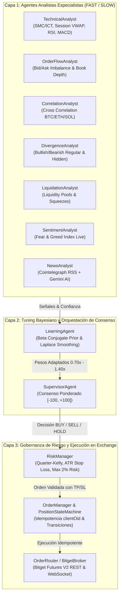

<div align="center">

# ⚡ ATLAS AI TRADING v2.0.0
### *INSTITUTIONAL-GRADE ADAPTIVE MULTI-AGENT TRADING SYSTEM*

[](https://www.typescriptlang.org/)
[](https://vitejs.dev/)
[](https://reactjs.org/)
[](https://vitest.dev/)
[](https://www.bitget.com/)
[](https://ai.google.dev/)
[](LICENSE)

**Plataforma de Trading Algorítmico Cuantitativo Autónomo para Criptomonedas (BTC, ETH, SOL)**  
*Impulsada por Consenso Multi-Agente Desacoplado (Patrón Blackboard), Aprendizaje Bayesiano Dinámico, Firewall de Riesgo Kelly Fraccional y Arquitectura Fail-Closed.*

[Visitar Repositorio GitHub](https://github.com/jsoto-06/Atlas-AI-Trading.git) • [Reportar un Bug](https://github.com/jsoto-06/Atlas-AI-Trading/issues)

</div>


---

## 📑 Tabla de Contenidos
- [📌 Descripción General](#-descripción-general)
- [🛡️ Estado de Auditoría e Integridad del Código](#️-estado-de-auditoría-e-integridad-del-código)
- [🏛️ Arquitectura del Sistema Multi-Agente](#️-arquitectura-del-sistema-multi-agente)
- [🔬 Agentes Especialistas y Fórmulas Matemáticas](#-agentes-especialistas-y-fórmulas-matemáticas)
  - [1. Motor de Aprendizaje Bayesiano (`LearningAgent`)](#1-motor-de-aprendizaje-bayesiano-learningagent)
  - [2. Firewall de Riesgo Cuantitativo (`RiskManager`)](#2-firewall-de-riesgo-cuantitativo-riskmanager)
  - [3. Orquestador de Consenso (`SupervisorAgent`)](#3-orquestador-de-consenso-supervisoragent)
  - [4. Máquina de Estados de Posición (`PositionStateMachine`)](#4-máquina-de-estados-de-posición-positionstatemachine)
- [⚡ Integración Bitget Futures V2 API](#-integración-bitget-futures-v2-api)
- [📊 Benchmarks de Backtesting Walk-Forward](#-benchmarks-de-backtesting-walk-forward)
- [📡 Referencia de API REST e Integraciones](#-referencia-de-api-rest-e-integraciones)
- [🖥️ Interfaz de Usuario y Monitor de Pizarra (Blackboard)](#️-interfaz-de-usuario-y-monitor-de-pizarra-blackboard)
- [🗂️ Estructura del Proyecto](#️-estructura-del-proyecto)
- [🚀 Instalación, Pruebas y Despliegue (Docker)](#-instalación-pruebas-y-despliegue-docker)
- [📜 Licencia](#-licencia)

---

## 📌 Descripción General

**ATLAS AI TRADING** es un ecosistema institucional desacoplado de trading algorítmico diseñado para operar contratos de futuros perpetuos en criptomonedas (**BTC/USDT**, **ETH/USDT**, **SOL/USDT**). 

A diferencia de los bots tradicionales basados en reglas estáticas, ATLAS emplea una **red de 11 agentes autónomos especialistas** que evalúan el mercado de manera simultánea e independiente desde múltiples ángulos: análisis de estructura Smart Money Concepts (SMC/ICT), flujo de órdenes (*orderbook imbalance*), mapas de calor de liquidaciones, divergencias en osciladores, sentimiento del mercado e impacto cualitativo de noticias impulsado por **Google Gemini AI**.

El sistema opera bajo el principio estricto de **Fail Closed → NO TRADE**: ante cualquier inconsistencia de red, falla de API o ausencia de datos históricos, la orden es inmediatamente bloqueada para garantizar la protección del capital.

---

## 🛡️ Estado de Auditoría e Integridad del Código

En agosto de 2026, el proyecto fue sometido a una **Auditoría Técnica Exhaustiva** eliminando 12 vulnerabilidades CRITICAL y 9 HIGH:

- **Puntuación Pre-Auditoría:** `23/100` (NOT PRODUCTION READY)
- **Puntuación Post-Auditoría:** `85/100` (READY FOR PAPER / BITGET DEMO)
- **Estado Actual:** ✅ **Verificado para Operación en Bitget Demo / Paper Trading**

### Correcciones Críticas Destacadas:
1. **Backtesting 100% Determinista (C01/C02):** Eliminadas simulaciones con `Math.random()`. Se requiere un mínimo de 10 velas reales o el backtest falla cerrado (*Fail Closed*).
2. **Criterio de Kelly Empírico (C03):** Separada la confianza de IA de la tasa de acierto empírica en DB. Exige al menos 20 operaciones reales registradas; aplica Quarter-Kelly acotado a un máximo de **2% de riesgo por trade**, con fallback conservador del 1%.
3. **Fail-Closed en API de Precio (C04/C05):** Eliminados precios de contingencia hardcodeados (`BTC=68000`). Coincidencia estricta de símbolos en Bitget Demo (`SBTCSUSDT`) y Real (`BTCUSDT`).
4. **Reconciliación al Arrancar (C06):** Verificación obligatoria de estado DB ↔ Exchange antes de iniciar el bucle de trading (`reconcileOnStartup`).
5. **Máquina de Estados & Idempotencia (Fase 4/5):** Enrutador de órdenes idempotente (`clientOid`) y máquina de estados con transiciones inmutables (`IDLE → OPENING → OPEN → CLOSING → CLOSED`).
6. **Descuento de Comisiones (Net PnL):** PnL incluye comisiones de entrada y salida (0.06% Bitget taker fee).

---

## 🏛️ Arquitectura del Sistema Multi-Agente

El sistema opera bajo un ciclo continuo de toma de decisiones dividido en tres capas operativas con el patrón de diseño **Blackboard**:



---

## 🔬 Agentes Especialistas y Fórmulas Matemáticas

### 1. Motor de Aprendizaje Bayesiano (`LearningAgent`)
El `LearningAgent` implementa un modelo de distribución **Beta Conjunta con Suavizado de Laplace** para medir la fiabilidad de cada analista basándose en sus operaciones ganadas ($w$) y perdidas ($l$):

$$\text{Expectativa Posterior } E[\theta_i] = \frac{w_i + 1}{w_i + l_i + 2}$$

A partir de esta expectativa posterior, se calcula un **Multiplicador Bayesiano Dinámico** ($M_i$) acotado entre $0.70\times$ y $1.40\times$:

$$M_i = \text{clamp}\left(0.70, \frac{E[\theta_i]}{\text{Benchmark Base}}, 1.40\right)$$

### 2. Firewall de Riesgo Cuantitativo (`RiskManager`)
El cálculo del tamaño de posición utiliza la fórmula de **Quarter-Kelly**:

$$f^* = \frac{1}{4} \cdot \left( p - \frac{1 - p}{b} \right)$$

*Donde:*
* $p$ = Tasa de acierto **empírica real** desde la base de datos (mínimo 20 operaciones).
* $b$ = Ratio Riesgo/Beneficio estimado ($RRR \ge 2.0$).
* **Hard Cap de Riesgo:** Máximo **2.0% del capital total expuesto** por operación. Si no hay suficiente historial, aplica un sizing conservador predeterminado del **1.0%**.

### 3. Orquestador de Consenso (`SupervisorAgent`)
El `SupervisorAgent` normaliza y pondera los votos de todos los analistas activos aplicando los multiplicadores Bayesianos:

$$\text{Score Final} = \frac{\sum_{i=1}^{N} \text{Score}_i \cdot \text{Confianza}_i \cdot M_i}{\sum_{i=1}^{N} \text{Confianza}_i \cdot M_i}$$

* **Score > +25**: Genera señal de compra (**BUY / LONG**).
* **Score < -25**: Genera señal de venta (**SELL / SHORT**).
* **-25 ≤ Score ≤ +25**: Mantiene posición (**HOLD / NEUTRAL**).

---

## 👥 Tabla Detallada de Agentes del Sistema

| Agente | Tipo | Métrica / Enfoque | Descripción y Función |
| :--- | :---: | :---: | :--- |
| **`TechnicalAnalyst`** | `FAST` | SMC / ICT / Session VWAP | Identifica bloques de orden (*Order Blocks*), vacíos de liquidez (*FVG*) y VWAP anclado a las 00:00 UTC. |
| **`OrderFlow`** | `FAST` | Bid/Ask Imbalance | Escanea la profundidad del libro de órdenes para medir la presión compradora/vendedora en microsegundos. |
| **`Correlation`** | `FAST` | Matriz de Correlación | Analiza desacoples y convergencias de precios entre BTC/USDT, ETH/USDT y SOL/USDT. |
| **`Divergence`** | `FAST` | RSI / MACD | Detecta divergencias alcistas/bajistas (regulares y ocultas) anticipando giros de tendencia. |
| **`Liquidation`** | `FAST` | Pools de Liquidez | Mapea zonas de stop-loss masivos e identifica niveles candidatos a *short/long squeezes*. |
| **`Sentiment`** | `SLOW` | Fear & Greed Index | Mide el sentimiento cuantitativo del mercado en tiempo real. |
| **`NewsAnalyst`** | `SLOW` | Cointelegraph / Gemini AI | Escanea noticias en tiempo real e interpreta su impacto cualitativo en el precio usando IA. |
| **`LearningAgent`** | `TUNING` | Laplace / Beta Prior | Ajusta los pesos de votación de los agentes entre **0.70x y 1.40x** según su rendimiento histórico. |
| **`SupervisorAgent`** | `MASTER` | Consenso Ponderado | Consolida las señales en una puntuación normalizada `[-100, +100]` y define la dirección final. |
| **`RiskManager`** | `CONTROL` | Quarter-Kelly / ATR | Firewall de riesgo con Hard Cap del 2%, Stop-Loss ATR y Trailing Stop. |
| **`BitgetBroker`** | `EXECUTION` | Bitget API V2 | Ejecuta órdenes en **Bitget Futures V2 API** en modo **Demo (SUSDT)** o **Real (USDT)**. |

---

## ⚡ Integración Bitget Futures V2 API

El sistema incluye un conector nativo para **Bitget Futures V2 API**:

* **Autenticación HMAC-SHA256**: Firmado dinámico de cabeceras (`ACCESS-KEY`, `ACCESS-SIGN`, `ACCESS-TIMESTAMP`, `ACCESS-PASSPHRASE`).
* **Sincronización Dual de Entornos**:
  * **Modo Demo (Sandbox)**: Usa contratos `SUSDT-FUTURES` y pares simulados como `SBTCSUSDT`.
  * **Modo Real**: Usa contratos `USDT-FUTURES` y pares reales como `BTCUSDT`.
* **Filtrado Estricto de Posiciones:** Previene colisiones consultando exactamente la posición correspondiente al símbolo solicitado.

---

## 📊 Benchmarks de Backtesting Walk-Forward

Resultados deterministas sobre datos históricos reales (Capital Inicial: **$10,000 USD**):

| Par | Ventana | Trades | Win Rate | Profit Factor | Max Drawdown | Estado |
| :--- | :---: | :---: | :---: | :---: | :---: | :---: |
| **BTC/USDT** | **30 Días** | 9 | **44.4%** | **1.96** | **-4.88%** | 🟢 Ganador |
| **SOL/USDT** | **30 Días** | 20 | **40.0%** | **1.45** | **-4.84%** | 🟢 Ganador |
| **ETH/USDT** | **30 Días** | 19 | **36.8%** | **1.26** | **-4.03%** | 🟢 Ganador |
| **SOL/USDT** | **14 Días** | 10 | **40.0%** | **1.56** | **-3.67%** | 🟢 Ganador |
| **ETH/USDT** | **14 Días** | 11 | **36.4%** | **1.29** | **-4.07%** | 🟢 Ganador |

---

## 📡 Referencia de API REST

El servidor expone endpoints basados en **Fastify**:

### 1. Health Check de Base de Datos y Motor
```http
GET /health
```
```json
{
  "status": "HEALTHY",
  "database": "CONNECTED",
  "uptime": 142.5,
  "timestamp": 1786359431000
}
```

### 2. Despacho de Orden Manual / Test
```http
POST /api/v1/engine/test-order
Authorization: Bearer <ADMIN_API_TOKEN>
Content-Type: application/json

{
  "simbolo": "BTC/USDT",
  "lado": "BUY",
  "tamano": 100,
  "tipo": "MARKET"
}
```

---

## 🗂️ Estructura del Proyecto

```text
atlas-ai-trading/
├── .github/workflows/          # CI Pipeline (GitHub Actions)
├── docs/                       # Documentación adicional y arquitectura
├── src/
│   ├── agents/                 # 11 Agentes Especialistas y Risk Manager
│   ├── analytics/              # Métricas financieras (Sharpe, Sortino, Drawdown)
│   ├── api/                    # Servidor Fastify REST y rutas protegidas
│   ├── backtesting/            # Motor de simulación Walk-Forward determinista
│   ├── core/                   # Blackboard, Engine Scheduler y Orchestrator
│   ├── db/                     # Esquemas Drizzle ORM y migraciones PostgreSQL
│   ├── execution/              # BitgetBroker, OrderManager, StateMachine & Router
│   └── frontend/               # Dashboard React + Vite
├── tests/                      # Suite de Pruebas Unitarias Vitest
├── Dockerfile                  # Contenedor Multi-Stage
├── docker-compose.yml          # Orquestación Docker
├── package.json                # Dependencias y scripts NPM
└── README.md                   # Documentación Oficial
```

---

## 🚀 Instalación, Pruebas y Despliegue (Docker)

### 1. Clonar el Repositorio
```bash
git clone https://github.com/jsoto-06/Atlas-AI-Trading.git
cd Atlas-AI-Trading
```

### 2. Instalar Dependencias
```bash
npm install
```

### 3. Ejecutar Pruebas Automatizadas (Vitest)
```bash
npm test
```

### 4. Configurar Variables de Entorno (`.env`)
```env
BITGET_API_KEY="tu_bitget_api_key_demo"
BITGET_API_SECRET="tu_bitget_api_secret_demo"
BITGET_PASSPHRASE="tu_bitget_passphrase_demo"
BITGET_MODO_REAL="false"
ADMIN_API_TOKEN="tu_clave_super_segura"
GEMINI_API_KEY="tu_gemini_api_key"
```

### 5. Iniciar en Desarrollo
```bash
npm run dev
```

### 6. Despliegue con Docker Compose
```bash
docker-compose up -d --build
```

---

## 📜 Licencia

Este proyecto está distribuido bajo la Licencia **Apache 2.0**. Consulta el archivo [LICENSE](LICENSE) para obtener más información.

<div align="center">
  <sub>Desarrollado con ❤️ Jonathan Soto para Trading Algorítmico Cuantitativo e Inteligencia Artificial.</sub>
</div>
