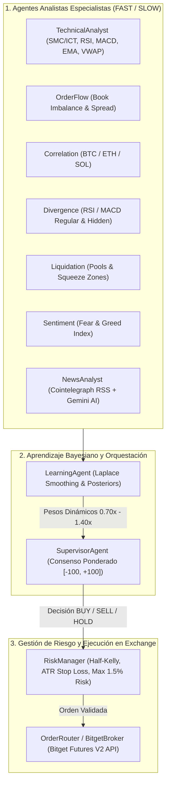

<div align="center">

# 🤖 ATLAS AI TRADING v1.2.0
### *INTELLIGENCE. ADAPTIVE. PROFITABLE.*

[](https://www.typescriptlang.org/)
[](https://vitejs.dev/)
[](https://reactjs.org/)
[](https://www.bitget.com/)
[](LICENSE)

**Sistema Autónomo Multi-Agente de Trading Algorítmico e Inteligencia Colectiva para Criptomonedas (BTC, ETH, SOL)**

</div>

---

## 📌 Descripción General

**ATLAS AI TRADING** es una plataforma desacoplada de trading cuantitativo de alto rendimiento impulsada por una arquitectura distribuida de **16 Agentes Especializados**. 

El sistema combina análisis técnico cuantitativo, Smart Money Concepts (SMC/ICT), análisis de flujo de órdenes en tiempo real, detección de liquidaciones y divergencias, seguimiento de sentimiento social y de noticias en vivo con la API de Google Gemini, junto a un **Motor de Aprendizaje Bayesiano (Laplace Smoothing)** que ajusta los pesos de votación de los agentes en tiempo real según su desempeño histórico.

---

## 🏛️ Arquitectura del Sistema Multi-Agente

El núcleo del sistema opera mediante un ciclo desacoplado en tres capas estructuradas:



---

## 👥 Catálogo Completo de Agentes

| Agente | Tipo | Categoría | Rol y Metodología |
| :--- | :---: | :---: | :--- |
| **`TechnicalAnalyst`** | `FAST` | Analista | Calcula estructuras SMC/ICT, pivotes, VWAP, EMA 20/50/200, RSI y MACD. |
| **`OrderFlow`** | `FAST` | Analista | Mide el desequilibrio entre órdenes de compra y venta (*Bid/Ask Imbalance*) y el spread del libro. |
| **`Correlation`** | `FAST` | Analista | Evalúa la matriz de correlación cruzada entre BTC/USDT, ETH/USDT y SOL/USDT. |
| **`Divergence`** | `FAST` | Analista | Detección algorítmica de divergencias alcistas y bajistas (regulares y ocultas) en osciladores. |
| **`Liquidation`** | `FAST` | Analista | Identifica niveles de concentración de stop-loss, mapas de calor de liquidación y zonas propensas a *squeezes*. |
| **`Sentiment`** | `SLOW` | Analista | Monitorea el índice de Miedo y Codicia (*Fear & Greed Index*) en tiempo real y tendencias del mercado. |
| **`NewsAnalyst`** | `SLOW` | Analista | Escanea feeds RSS de Cointelegraph y utiliza Gemini AI para clasificar el impacto fundamental. |
| **`LearningAgent`** | `TUNING` | Aprendizaje | **Ajuste Bayesiano de Pesos**: Aplica suavizado de Laplace (distribución Beta) para recalibrar los pesos de los analistas de **0.70x a 1.40x** según su histórico de aciertos. |
| **`SupervisorAgent`** | `MASTER` | Orquestador | Pondera los 7 votos analíticos con los multiplicadores Bayesianos para generar el **Score de Consenso final (`-100` a `+100`)**. |
| **`RiskManager`** | `CONTROL` | Gestión | Define el tamaño posicional mediante **Half-Kelly Criterion**, límite máximo de riesgo (1.5% capital), apalancamiento 10x y Stop Loss por ATR. |
| **`BitgetBroker`** | `EXECUTION` | Broker | Adaptador de ejecución con firmas HMAC-SHA256 para **Bitget Futures API V2** en entornos **Demo (SUSDT)** y **Real (USDT)**. |

---

## 📈 Rendimiento Comprobado (Backtesting)

Resultados obtenidos en simulaciones sobre velas históricas con un capital base de **$100 USD**:

| Par | Periodo | Rentabilidad | Win Rate | Profit Factor | Max Drawdown |
| :--- | :---: | :---: | :---: | :---: | :---: |
| **SOL/USDT** | 14 Días | **+2.77% (+$2.77)** | 36.4% | 1.27 | -5.92% |
| **SOL/USDT** | 30 Días | **+4.47% (+$4.47)** | 36.4% | 1.21 | -7.55% |
| **BTC/USDT** | 14 Días | **+4.37% (+$4.37)** | 50.0% | 1.86 | -6.53% |
| **BTC/USDT** | 30 Días | **+2.60% (+$2.60)** | 40.0% | 1.26 | -7.56% |

---

## ✨ Características Clave del Sistema

* ⚡ **WebSocket Bitget en Vivo**: Feed en tiempo real para cotizaciones y actualización de saldos disponibles.
* 🛡️ **Presupuesto de Riesgo Dinámico**: Algoritmo estricto Half-Kelly que limita el riesgo a un máximo de 1.5% del balance de margen.
* 🕹️ **Ordenador Manual / Semi-Auto**: Consola interactiva para despachar órdenes LONG/SHORT a mercado y testear la API del Exchange.
* 📋 **Blackboard Monitor**: Tablero transparente con la puntuación y nivel de confianza individual de los 16 agentes activos.
* 🔌 **API Rest Interna**: Endpoints HTTP (`/api/v1/engine/test-order`, `/api/v1/telemetry/config`) para integración de comandos y telemetría.
* 🔄 **Compatibilidad Bitget Futures V2**: Protocolo de firma robusto adaptado para Modo Unilateral (One-Way) y Modo Cobertura (Hedge).

---

## 💻 API Endpoints Principales

* `POST /api/v1/engine/test-order`: Despacha una orden de prueba manual a mercado en Bitget Futures.
* `POST /api/v1/telemetry/config`: Actualiza credenciales API (Key, Secret, Passphrase) en caliente sin reiniciar el servidor.
* `GET /api/v1/metrics`: Retorna telemetría completa del sistema, estado del blackboard y saldos.

---

## 🚀 Instalación y Uso Local

### Requisitos Previos
* Node.js (v18.0 o superior)
* Git

### 1. Clonar el Repositorio
```bash
git clone https://github.com/jsoto-06/Atlas-AI-Trading.git
cd Atlas-AI-Trading
```

### 2. Instalar Dependencias
```bash
npm install
```

### 3. Configurar Variables de Entorno
Crea un archivo `.env` en la raíz del proyecto (puedes guiarte con `.env.example`):

```env
# GEMINI API KEY (Opcional - Análisis de Noticias)
GEMINI_API_KEY=tu_gemini_api_key

# CREDENCIALES BITGET (Opcionales - Se pueden configurar desde la UI)
BITGET_API_KEY=tu_bitget_api_key
BITGET_API_SECRET=tu_bitget_api_secret
BITGET_PASSPHRASE=tu_bitget_passphrase
BITGET_MODO_REAL=false
```

### 4. Iniciar la Aplicación
```bash
npm run dev
```
Accede en tu navegador a `http://localhost:5173`.

---

## 📄 Licencia

Distribuido bajo la Licencia **Apache 2.0**. Consulta el archivo `LICENSE` para obtener más información.
