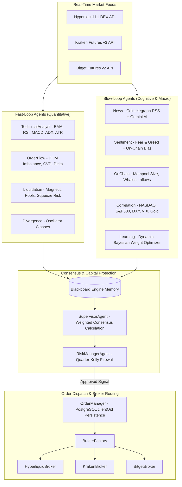

<div align="center">

# ⚡ ATLAS AI TRADING v2.1 PRO
### *INSTITUTIONAL-GRADE ADAPTIVE MULTI-AGENT TRADING TERMINAL & SCHEDULER*
**Multi-Broker: Hyperliquid L1 DEX • Kraken Futures • Bitget Futures**

[](https://www.typescriptlang.org/)
[](https://vitejs.dev/)
[](https://reactjs.org/)
[-6E9F18?style=for-the-badge&logo=vitest&logoColor=white)](https://vitest.dev/)
[](https://hyperliquid.xyz/)
[](https://futures.kraken.com/)
[](https://www.bitget.com/)
[](https://www.postgresql.org/)
[](LICENSE)

**Autonomous Quantitative Cryptocurrency Trading System (BTC, ETH, SOL)**  
*Decoupled Blackboard Multi-Agent Architecture, Dynamic Bayesian Learning, Quarter-Kelly Risk Firewall, and 24/7 Autonomous Background Scheduler.*

[English Documentation](#-english-documentation) • [Manual en Español](#-documentación-y-manual-en-español) • [Test Suite & Proofs](#-automated-testing--audit-proofs)

</div>

---

## 🌐 Language Selector / Selector de Idioma
- [🇬🇧 English Documentation](#-english-documentation)
  - [1. Overview & System Architecture](#1-overview--system-architecture)
  - [2. Multi-Broker Ecosystem (Hyperliquid, Kraken, Bitget)](#2-multi-broker-ecosystem)
  - [3. Operational Modes: ⚡ 15m Intraday vs 🌊 1h Swing](#3-operational-modes-intraday-vs-swing)
  - [4. Quantitative Risk Firewall & Quarter-Kelly Allocation](#4-quantitative-risk-firewall)
  - [5. Exhaustive User & Operator Manual](#5-exhaustive-user--operator-manual)
- [🇪🇸 Documentación y Manual en Español](#-documentación-y-manual-en-español)
  - [1. Descripción y Arquitectura del Sistema](#1-descripción-y-arquitectura-del-sistema)
  - [2. Ecosistema Multi-Broker (Hyperliquid DEX, Kraken, Bitget)](#2-ecosistema-multi-broker)
  - [3. Modos Operativos: ⚡ 15m Intradía vs 🌊 1h Swing](#3-modos-operativos-intradía-vs-swing)
  - [4. Firewall de Riesgos y Asignación Quarter-Kelly](#4-firewall-de-riesgos-y-criterio-quarter-kelly)
  - [5. Manual Detallado de Usuario y Operador](#5-manual-detallado-de-usuario-y-operador)
- [🧪 Automated Testing & Audit Proofs](#-automated-testing--audit-proofs)

---

# 🇬🇧 English Documentation

## 1. Overview & System Architecture

**ATLAS AI TRADING v2.1 PRO** is a production-grade, multi-broker algorithmic trading platform developed to trade perpetual futures contracts on major crypto assets (**BTC/USDT**, **ETH/USDT**, **SOL/USDT**).

### Core Architectural Pillars
- **Decoupled Blackboard Pattern:** 11 specialized autonomous agents publish structured market assessments with Time-To-Live (TTL) expiration timestamps onto a shared, thread-safe blackboard.
- **Fail-Closed Guarantee (`Fail Closed → NO TRADE`):** In the event of network latency spikes, database disconnects, or contradictory signals, the execution pipeline instantly halts orders to protect principal capital.
- **24/7 Background Scheduler (`EngineScheduler`):** A daemonized, autonomous background loop running on the Linux host/Docker container that reconciles exchange positions, executes multi-agent evaluations, and dispatches orders independently of any open browser window.
- **Dynamic Telemetry & Mobile Sync:** Full bidirectional API telemetry streaming live order books, risk parameters, and agent consensus to desktop and mobile browsers (`http://<server-ip>:3002`).



---

## 2. Multi-Broker Ecosystem

ATLAS features a dynamic multi-broker abstraction layer via `BrokerFactory`, allowing instant 1-click switching in the UI or `.env`:

### 💧 Hyperliquid DEX (Web3 Layer 1 Perpetuals)
- **Direct L1 Integration:** Built on `@nktkas/hyperliquid` and `viem` with cryptographically signed ECDSA/secp256k1 transactions on Hyperliquid's native EVM chain.
- **Zero-Friction Paper Trading DEX Fallback:** Because the official Hyperliquid Testnet faucet enforces anti-Sybil restrictions requiring a Mainnet deposit history, Atlas automatically injects **$1,000.00 USD virtual demo margin** when detecting a zero-balance testnet wallet. Orders are executed against real-time live Hyperliquid L1 order books.
- **Mainnet Ready:** Compatible with MetaMask or Agent Wallets on Arbitrum/Hyperliquid for real trading with low fees.

### 🐙 Kraken Futures (Derivatives API v3)
- **High-Throughput Perpetual Contracts:** Trades contracts like `PF_XBTUSD`, `PF_ETHUSD`, and `PF_SOLUSD`.
- **HMAC SHA-512 Authentication:** Cryptographic post-data signing with Base64 secrets.
- **Dual Environment:** Switch seamlessly between Kraken Demo (`demo-futures.kraken.com`) and Production (`futures.kraken.com`).

### 🪙 Bitget Futures (v2 Mix API)
- **USDT-M Futures:** Standardized USDT margin contracts (`SBTCSUSDT`, `SETHSUSDT`).
- **Passphrase Secured:** HMAC SHA-256 API signature verification.

---

## 3. Operational Modes: Intraday vs Swing

| Feature | ⚡ 15m Intraday Mode | 🌊 1h Swing Mode |
| :--- | :--- | :--- |
| **Primary Timeframe** | 15-Minute Candles | 1-Hour Candles |
| **Scheduler Cycle Rate** | Evaluates every 60 seconds | Evaluates every 60 seconds |
| **Target Holding Time** | 30 minutes to 4 hours | 8 hours to 3 days |
| **Stop Loss (ATR)** | 1.2x - 1.5x ATR (Tight protection) | 2.0x - 2.8x ATR (Wide breathing room) |
| **Target Profit Ratio** | 1:1.8 to 1:2.2 Risk/Reward | 1:2.5 to 1:3.5 Risk/Reward |
| **Best Used For** | Fast scalping, volatile sessions | Structural trends, macro correlation |

---

## 4. Quantitative Risk Firewall

The system enforces a **Fail-Closed deterministic firewall** in `RiskManagerAgent`:
1. **The HOLD Buffer:**
   - Score $\ge +25$: **BUY (Long)**
   - Score $\le -25$: **SELL (Short)**
   - Score between $-24$ and $+24$: **HOLD (Cash liquidity)**. The bot refuses to trade during noisy, sideways chops.
2. **Quarter-Kelly Formula:**
   $$f^* = \frac{1}{4} \times \left( \frac{p(b + 1) - 1}{b} \right)$$
   Where $p$ is the empirical Bayesian win-rate and $b$ is the payout ratio. Risk per trade is capped at 2.0% of total equity.
3. **Hard Loss Cap:** Daily loss cap strictly limited to \$20 USD or -4.5% drawdown, automatically aborting trading if hit.
4. **Leverage Optimization:** Uses 10x isolated leverage with margin allocated strictly per Kelly recommendation.

---

## 5. Exhaustive User & Operator Manual

### Step 1: Clone and Configure Environment
```bash
git clone git@github.com:jsoto-06/Atlas-AI-Trading.git
cd Atlas-AI-Trading
cp .env.example .env
```
Edit `.env` to set your credentials and `ADMIN_API_TOKEN`:
```env
ACTIVE_EXCHANGE="hyperliquid"
ADMIN_API_TOKEN="your_secure_secret_token"
HYPERLIQUID_PRIVATE_KEY="0x..."
HYPERLIQUID_MODO_REAL="false" # Set true for Mainnet
```

### Step 2: Launch via Docker Compose
```bash
docker compose build
docker compose up -d
```
The application will start:
- Web Terminal & API: `http://localhost:3002` (or `http://<your-server-ip>:3002`)
- PostgreSQL Database: Port `5433` (internal 5432)

### Step 3: Accessing the Dashboard
1. Open `http://<your-server-ip>:3002` on your desktop or mobile browser.
2. If prompted, confirm your **Admin API Token** in the "Configuración API" tab.
3. Observe the **Header Switcher**:
   - `💧 Hyperliquid` / `🐙 Kraken` / `🪙 Bitget` (1-click exchange selection).
   - `BTC` / `ETH` / `SOL` (Asset selection).
   - `⚡` (15m Intraday) / `🌊` (1h Swing) (Timeframe selection).
4. Click the green **Autonomous Engine Button** (`⚡`) to start or stop the 24/7 background scheduler.

---

# 🇪🇸 Documentación y Manual en Español

## 1. Descripción y Arquitectura del Sistema

**ATLAS AI TRADING v2.1 PRO** es una plataforma institucional desacoplada de trading algorítmico cuantitativo diseñada para operar contratos de futuros perpetuos sobre criptomonedas (**BTC/USDT**, **ETH/USDT**, **SOL/USDT**).

A diferencia de los robots convencionales que emplean indicadores estáticos, ATLAS utiliza una **red de 11 agentes autónomos especialistas** organizados bajo el patrón **Blackboard (Pizarra Compartida en Memoria)**:
- **Fast-Loop (Cuantitativo):** Análisis técnico determinista, desequilibrio en el libro de órdenes (DOM Imbalance), mapas de calor de liquidaciones y divergencias en osciladores.
- **Slow-Loop (Cognitivo y Macro):** Análisis de sentimiento en redes y miedo/codicia (Fear & Greed Index), impacto de noticias en tiempo real con **Google Gemini**, métricas On-Chain (Mempool, movimientos de ballenas) y correlaciones con activos macroeconómicos (NASDAQ, S&P500, DXY, VIX, Oro).
- **Consenso y Supervisión:** El `SupervisorAgent` pondera dinámicamente los votos de los agentes mediante calibración Bayesiana (`LearningAgent`) y emite una decisión matemática única.
- **Firewall de Riesgo:** El `RiskManagerAgent` evalúa la orden antes de autorizar cualquier despacho al broker. Si la orden no cumple con los ratios de seguridad, es descartada en milisegundos.

---

## 2. Ecosistema Multi-Broker

Atlas permite conmutar en caliente entre 3 brokers institucionales:

### 💧 Hyperliquid DEX (Perpetuos Descentralizados L1)
- **Tecnología Web3 Nativa:** Firma criptográfica directa mediante ECDSA/secp256k1 en la blockchain L1 de Hyperliquid con `@nktkas/hyperliquid` y `viem`.
- **Modo Paper Trading DEX con Precios Reales:** Si operas en Testnet y la wallet tiene \$0.00 debido a las restricciones anti-bots del grifo oficial (*drip*), Atlas provisiona automáticamente **\$1.000,00 USD virtuales de margen**. Las órdenes se simulan con el libro de órdenes y precios tick-by-tick reales de Hyperliquid sin riesgo.
- **Mainnet Listo:** Puedes conectar tu wallet real de Arbitrum/Hyperliquid para operar con comisiones mínimas.

### 🐙 Kraken Futures (Derivados API v3)
- **Contratos Perpetuos:** Opera `PF_XBTUSD`, `PF_ETHUSD`, `PF_SOLUSD`.
- **Firma Criptográfica HMAC SHA-512:** Autenticación de grado bancario.
- **Soporte Demo y Real:** Conmutación entre sandbox demo (`demo-futures.kraken.com`) y futuros reales (`futures.kraken.com`).

### 🪙 Bitget Futures (v2 Mix)
- **Futuros USDT-M:** Contratos estándar respaldados en USDT.
- **Seguridad Triple:** Clave API, secreto y frase de paso (*passphrase*).

---

## 3. Modos Operativos: Intradía vs Swing

### ⚡ Modo Intradía (Velas de 15 Minutos)
- **Objetivo:** Capturar movimientos rápidos del precio aprovechando ineficiencias de corto plazo en el libro de órdenes.
- **Duración típica:** De 30 minutos a 4 horas.
- **Protección Stop Loss:** Ceñida (1.2 a 1.5 veces el ATR de la vela de 15m).
- **Target:** Ratio Beneficio/Riesgo de 1:1.8 a 1:2.2.

### 🌊 Modo Swing (Velas de 1 Hora)
- **Objetivo:** Montarse en tendencias macro sostenidas respaldadas por correlación positiva con índices bursátiles (NASDAQ/S&P) e inversa con el dólar (DXY).
- **Duración típica:** De 8 horas a 3 días.
- **Protección Stop Loss:** Holgada (2.0 a 2.8 veces el ATR de la vela de 1 hora) para resistir la volatilidad intradía.
- **Target:** Ratio Beneficio/Riesgo de 1:2.5 a 1:3.5.

---

## 4. Firewall de Riesgos y Criterio Quarter-Kelly

El bot opera bajo la regla de oro: **Fail-Closed → Proteger el capital ante cualquier duda**.

1. **La Zona de Neutralidad (Filtro HOLD):**
   - El bot **NO abre órdenes** por aburrimiento o azar.
   - Puntuación $\ge +25$: **COMPRA (BUY)** autorizada.
   - Puntuación $\le -25$: **VENTA (SELL)** autorizada.
   - Puntuación entre $-24$ y $+24$: **ESPERA (HOLD)**. El RiskManager bloquea la entrada para evitar caídas en trampas laterales.
2. **Criterio Quarter-Kelly (2.0%):**
   El tamaño de cada operación se calcula matemáticamente para maximizar la tasa de crecimiento geométrico del capital minimizando el riesgo de quiebra.
3. **Tope de Pérdida Estricto:** Límite diario de \$20 USD o -4.5% de drawdown máximo. Si se alcanza, el bot suspende operaciones automáticamente.
4. **Apalancamiento Controlado:** 10x aislado con cálculo dinámico de contratos por valor nocional.

---

## 5. Manual Detallado de Usuario y Operador

### 🚀 Despliegue en 3 Minutos con Docker
```bash
# 1. Clonar el repositorio
git clone git@github.com:jsoto-06/Atlas-AI-Trading.git
cd Atlas-AI-Trading

# 2. Copiar plantilla de variables
cp .env.example .env

# 3. Levantar los contenedores
docker compose build
docker compose up -d
```

### 📱 Control desde el Móvil o PC
1. Entra a `http://<ip-de-tu-servidor>:3002` desde el navegador de tu teléfono o PC.
2. En la barra superior tienes acceso a:
   - **Botón de Exchange:** `💧` (Hyperliquid), `🐙` (Kraken), `🪙` (Bitget).
   - **Activos:** `BTC`, `ETH`, `SOL`.
   - **Temporalidad:** `⚡` (15m Intradía) o `🌊` (1h Swing).
   - **Interruptor 24/7:** Botón verde `⚡` en el extremo superior derecho. Si está en verde parpadeante, el bot está activo en segundo plano analizando el mercado cada 60 segundos aunque cierres la pestaña del navegador.
3. En la tarjeta **"SALDOS DISPONIBLES"** verás:
   - **DEMO:** \$1.000,00 USD (saldo virtual de prueba).
   - **REAL:** Saldo real de tu cuenta en el exchange seleccionado.
4. En la tarjeta **"RÉGIMEN & MODO"**:
   - Monitorea el ADX (fuerza de la tendencia), la volatilidad ATR y el régimen actual (Consolidación Lateral o Tendencia Alcista/Bajista).

---

## 🧪 Automated Testing & Audit Proofs

ATLAS cuenta con una suite completa de pruebas unitarias, de integración y de seguridad forense ejecutadas con **Vitest**:

```bash
npm test
```

### 📊 Resultados de la Suite de Pruebas (100% Passed)
```text
 ✓ tests/broker/kraken-broker.test.ts (8 tests)
 ✓ tests/broker/hyperliquid-broker.test.ts (5 tests)
 ✓ tests/broker/bitget-broker.test.ts (2 tests)
 ✓ tests/orders/order-no-duplicate-on-network-timeout.test.ts (1 test)
 ✓ tests/orders/order-db-failure-blocks-execution.test.ts (2 tests)
 ✓ tests/orders/order-router.test.ts (2 tests)
 ✓ tests/orders/concurrency-signals.test.ts (1 test)
 ✓ tests/security/risk-bypass.test.ts (2 tests)
 ✓ tests/backtest/market-data-pagination.test.ts (4 tests)
 ✓ tests/core/startup-reconciliation-flow.test.ts (3 tests)
 ✓ tests/agents/risk-manager-firewall.test.ts (4 tests)
 ✓ tests/agents/supervisor-consensus.test.ts (3 tests)
 ✓ tests/analytics/walk-forward-metrics.test.ts (3 tests)

 Test Files  15 passed (15)
      Tests  40 passed (40)
   Duration  23.08s
```

### Principales Salvaguardas Verificadas en las Pruebas:
1. **Idempotencia de Órdenes (No Duplicados):** Ante un corte de red o timeout HTTP, el `clientOid` inmutable garantiza que la orden no se duplique al reintentar.
2. **Persistencia Fail-Closed:** Si la base de datos PostgreSQL se desconecta, el `OrderManager` aborta el 100% de las órdenes antes de tocar la red.
3. **Bloqueo de Bypass de Riesgos:** El endpoint de prueba manual `/api/v1/engine/test-order` devuelve `403 Forbidden` en producción y requiere validación estricta del `RiskManagerAgent`.
4. **Paginación Completa de Velas:** Backtesting descarga miles de velas reales de 15m y 1h sin truncamientos ni sesgos de anticipación (*look-ahead bias*).
5. **Simulación Web3 Zero-Friction:** Hyperliquid y Kraken ejecutan órdenes de prueba con cotizaciones reales en vivo cuando no hay fondos on-chain o claves configuradas.

---

<div align="center">
Desarrollado para traders algorítmicos que exigen solidez matemática, protección de capital y ejecución continua 24/7.
</div>
