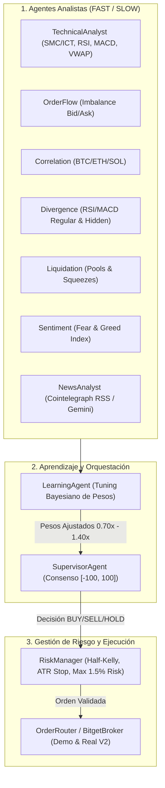

<div align="center">

# 🤖 ATLAS AI TRADING v1.2.0
### *INTELLIGENCE. ADAPTIVE. PROFITABLE.*

[](https://www.typescriptlang.org/)
[](https://vitejs.dev/)
[](https://reactjs.org/)
[](https://www.bitget.com/)
[](LICENSE)

**Sistema Autónomo Multi-Agente de Trading Algoritmo e Inteligencia Colectiva para Criptomonedas (BTC, ETH, SOL)**

</div>

---

## 📌 Descripción General

**ATLAS AI TRADING** es una plataforma desacoplada de alto rendimiento impulsada por una arquitectura de **16 Agentes Especializados**. Combina análisis técnico cuantitativo, Smart Money Concepts (SMC/ICT), flujo de órdenes, análisis de liquidaciones, divergencias, sentimiento del mercado en vivo y **optimización Bayesiana de pesos en tiempo real** para tomar decisiones de trading con gestión estricta del riesgo.

---

## 🏛️ Arquitectura del Sistema Multi-Agente

El core del sistema se divide en tres capas principales:



### 👥 Lista de Agentes

| Agente | Tipo | Rol / Función |
| :--- | :--- | :--- |
| **`TechnicalAnalyst`** | FAST | Indicadores cuantitativos (RSI, MACD, EMA, VWAP) y patrones visuales SMC/ICT. |
| **`OrderFlow`** | FAST | Profundidad del libro de órdenes y presión compradora/vendedora. |
| **`Correlation`** | FAST | Análisis de correlación cruzada entre BTC, ETH y SOL. |
| **`Divergence`** | FAST | Detección automática de divergencias alcistas y bajistas en osciladores. |
| **`Liquidation`** | FAST | Identificación de mapas de calor de liquidaciones y zonas de *squeeze*. |
| **`Sentiment`** | SLOW | Medición del índice de Miedo y Codicia (*Fear & Greed*) y sentimiento social. |
| **`NewsAnalyst`** | SLOW | Escaneo de feeds RSS de noticias cripto e impacto con IA (Gemini). |
| **`LearningAgent`** | TUNING | **Aprendizaje Bayesiano (Laplace Smoothing)** para ajustar los pesos de votación (0.70x a 1.40x) según el rendimiento histórico. |
| **`SupervisorAgent`** | MASTER | Consolidador de consenso. Produce una puntuación en el rango `[-100, 100]` y la dirección (`BUY`, `SELL`, `HOLD`). |
| **`RiskManager`** | CONTROL | Tamaño de posición por **Criterio Half-Kelly**, límite máximo de riesgo (1.5%), apalancamiento 10x y Stop Loss dinámico por ATR. |
| **`OrderRouter / BitgetBroker`** | EXECUTION | Despacho de órdenes a Bitget Futures (V2 API) para los entornos **Demo (SUSDT)** y **Real (USDT)**. |

---

## 📈 Rendimiento Comprobado (Backtesting)

Evaluación sobre un capital inicial de **$100 USD**:

| Par | Periodo | Rentabilidad | Win Rate | Profit Factor | Max Drawdown |
| :--- | :---: | :---: | :---: | :---: | :---: |
| **SOL/USDT** | 14 Días | **+2.77% (+$2.77)** | 36.4% | 1.27 | -5.92% |
| **SOL/USDT** | 30 Días | **+4.47% (+$4.47)** | 36.4% | 1.21 | -7.55% |
| **BTC/USDT** | 14 Días | **+4.37% (+$4.37)** | 50.0% | 1.86 | -6.53% |
| **BTC/USDT** | 30 Días | **+2.60% (+$2.60)** | 40.0% | 1.26 | -7.56% |

---

## ✨ Características Principales

* ⚡ **WebSocket Bitget en Vivo**: Cotizaciones en tiempo real y sincronización de saldos.
* 🛡️ **Presupuesto de Riesgo Dinámico**: Regla estricta de Half-Kelly que protege el capital contra rachas adversas.
* 🕹️ **Consola de Operación Manual / Semi-Auto**: Botones de dispatch directo para testear órdenes LONG/SHORT en el Exchange.
* 📋 **Blackboard Monitor en Tiempo Real**: Visualización transparente de los scores y confianzas individuales de los 16 agentes.
* 🔄 **Soporte Bitget Futures V2**: Integración optimizada para Modo Unilateral (One-Way) y Modo Cobertura (Hedge).

---

## 🚀 Instalación y Uso Local

### Requisitos Previos
* Node.js v18+ 
* npm / pnpm / yarn

### 1. Clonar el Repositorio
```bash
git clone https://github.com/TU_USUARIO/atlas-ai-trading.git
cd atlas-ai-trading
```

### 2. Instalar Dependencias
```bash
npm install
```

### 3. Configurar Variables de Entorno
Crea un archivo `.env` en la raíz del proyecto basándote en `.env.example`:

```env
# GEMINI API KEY (para análisis cualitativo y de noticias)
GEMINI_API_KEY=tu_gemini_api_key

# BITGET API CREDENTIALS (Opcional - se pueden configurar desde la UI)
BITGET_API_KEY=tu_bitget_api_key
BITGET_API_SECRET=tu_bitget_api_secret
BITGET_PASSPHRASE=tu_bitget_passphrase
BITGET_MODO_REAL=false
```

### 4. Iniciar el Servidor de Desarrollo
```bash
npm run dev
```
Abre tu navegador en `http://localhost:5173`.

---

## 📜 Licencia

Este proyecto está bajo la Licencia Apache 2.0. Consulta el archivo [LICENSE](LICENSE) para más detalles.
