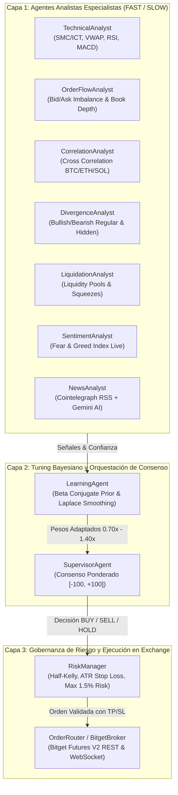

<div align="center">

# ⚡ ATLAS AI TRADING v1.2.0
### *INSTITUTIONAL-GRADE ADAPTIVE MULTI-AGENT TRADING SYSTEM*

[](https://www.typescriptlang.org/)
[](https://vitejs.dev/)
[](https://reactjs.org/)
[](https://nodejs.org/)
[](https://www.bitget.com/)
[](https://ai.google.dev/)
[](LICENSE)

**Plataforma de Trading Algorítmico Cuantitativo Autónomo para Criptomonedas (BTC, ETH, SOL)**  
*Impulsada por Consenso Multi-Agente Desacoplado, Aprendizaje Bayesiano Dinámico y Gestión de Riesgo Half-Kelly.*

[Visitar Repositorio GitHub](https://github.com/jsoto-06/Atlas-AI-Trading.git) • [Reportar un Bug](https://github.com/jsoto-06/Atlas-AI-Trading/issues)

</div>

---

## 📑 Tabla de Contenidos
- [📌 Descripción General](#-descripción-general)
- [🏛️ Arquitectura del Sistema Multi-Agente](#️-arquitectura-del-sistema-multi-agente)
- [🔬 Agentes Especialistas y Fórmulas Matemáticas](#-agentes-especialistas-y-fórmulas-matemáticas)
  - [1. Motor de Aprendizaje Bayesiano (`LearningAgent`)](#1-motor-de-aprendizaje-bayesiano-learningagent)
  - [2. Presupuesto de Riesgo (`RiskManager`)](#2-presupuesto-de-riesgo-riskmanager)
  - [3. Orquestador de Consenso (`SupervisorAgent`)](#3-orquestador-de-consenso-supervisoragent)
- [⚡ Integración Bitget Futures V2 API](#-integración-bitget-futures-v2-api)
- [📊 Benchmarks de Backtesting (Cuantitativo)](#-benchmarks-de-backtesting-cuantitativo)
- [📡 Referencia de API REST e Integraciones](#-referencia-de-api-rest-e-integraciones)
- [🖥️ Interfaz de Usuario y Monitor de Pizarra (Blackboard)](#️-interfaz-de-usuario-y-monitor-de-pizarra-blackboard)
- [🗂️ Estructura del Proyecto](#️-estructura-del-proyecto)
- [🚀 Instalación y Despliegue Local](#-instalación-y-despliegue-local)
- [📜 Licencia](#-licencia)

---

## 📌 Descripción General

**ATLAS AI TRADING** es un ecosistema institucional desacoplado de trading algorítmico diseñado para operar contratos de futuros perpetuos en criptomonedas (**BTC/USDT**, **ETH/USDT**, **SOL/USDT**). 

A diferencia de los bots tradicionales basados en reglas estáticas, ATLAS emplea una **red de 16 agentes autónomos especialistas** que evalúan el mercado de manera simultánea e independiente desde múltiples ángulos: análisis de estructura Smart Money Concepts (SMC/ICT), flujo de órdenes (*orderbook imbalance*), mapas de calor de liquidaciones, divergencias en osciladores, sentimiento del mercado e impacto cualitativo de noticias impulsado por **Google Gemini AI**.

Un **Motor de Aprendizaje Bayesiano (Laplace Smoothing)** evalúa continuamente la tasa de aciertos real de cada agente analista para ajustar dinámicamente sus pesos de votación en tiempo real.

---

## 🏛️ Arquitectura del Sistema Multi-Agente

El sistema opera bajo un ciclo continuo de toma de decisiones dividido en tres capas operativas:



---

## 🔬 Agentes Especialistas y Fórmulas Matemáticas

### 1. Motor de Aprendizaje Bayesiano (`LearningAgent`)
El `LearningAgent` implementa un modelo de distribución **Beta Conjunta con Suavizado de Laplace** para medir la fiabilidad de cada analista basándose en sus operaciones ganadas ($w$) y perdidas ($l$):

$$\text{Posterior Expectation } E[\theta_i] = \frac{w_i + 1}{w_i + l_i + 2}$$

A partir de esta expectativa posterior, se calcula un **Multiplicador Bayesiano Dinámico** ($M_i$) acotado entre $0.70\times$ y $1.40\times$:

$$M_i = \text{clamp}\left(0.70, \frac{E[\theta_i]}{\text{Benchmark Base}}, 1.40\right)$$

### 2. Presupuesto de Riesgo (`RiskManager`)
El cálculo del tamaño óptimo de la posición utiliza la **Fórmula de Half-Kelly**:

$$f^* = \frac{1}{2} \cdot \left( p - \frac{1 - p}{b} \right)$$

*Donde:*
* $p$ = Probabilidad estimada de éxito derivada de la confianza del `SupervisorAgent`.
* $b$ = Ratio Riesgo/Beneficio estimado (Risk-Reward Ratio).
* **Límite Estricto**: Máximo 1.5% del capital total expuesto por operación, con Stop Loss dinámico calculado mediante el **ATR (Average True Range)**.

### 3. Orquestador de Consenso (`SupervisorAgent`)
El `SupervisorAgent` normaliza y pondera los votos de todos los analistas activos aplicando los multiplicadores Bayesianos:

$$\text{Score Final} = \frac{\sum_{i=1}^{N} \text{Score}_i \cdot \text{Confianza}_i \cdot M_i}{\sum_{i=1}^{N} \text{Confianza}_i \cdot M_i}$$

* **Score > +25**: Genera señal de compra (**BUY / LONG**).
* **Score < -25**: Genera señal de venta (**SELL / SHORT**).
* **-25 ≤ Score ≤ +25**: Mantiene posición (**HOLD / NEUTRAL**).

---

## 👥 Tabla Detallada de Agentes del Sistema

| Agente | Tipo | Métrica / Enfoque | Descripción y Función |
| :--- | :---: | :---: | :--- |
| **`TechnicalAnalyst`** | `FAST` | SMC / ICT / VWAP | Identifica bloques de orden (*Order Blocks*), vacíos de liquidez (*Fair Value Gaps*), pivotes y VWAP. |
| **`OrderFlow`** | `FAST` | Bid/Ask Imbalance | Escanea la profundidad del libro de órdenes para medir la presión de compra o venta en microsegundos. |
| **`Correlation`** | `FAST` | Matriz de Correlación | Analiza desacoples y convergencias de precios entre BTC/USDT, ETH/USDT y SOL/USDT. |
| **`Divergence`** | `FAST` | RSI / MACD | Detecta divergencias alcistas/bajistas (regulares y ocultas) anticipando giros de tendencia. |
| **`Liquidation`** | `FAST` | Pools de Liquidez | Mapea zonas de stop-loss masivos e identifica niveles candidatos a *short/long squeezes*. |
| **`Sentiment`** | `SLOW` | Fear & Greed Index | Mide el sentimiento cuantitativo del mercado (ej. Miedo Extremo 30/100 vs Codicia 80/100). |
| **`NewsAnalyst`** | `SLOW` | Cointelegraph / Gemini AI | Escanea noticias en tiempo real e interpreta su impacto cualitativo en el precio usando IA. |
| **`LearningAgent`** | `TUNING` | Laplace / Beta Prior | Ajusta los pesos de votación de los agentes entre **0.70x y 1.40x** según su rendimiento histórico. |
| **`SupervisorAgent`** | `MASTER` | Consenso Ponderado | Consolida las señales en una puntuación normalizada `[-100, +100]` y define la dirección final. |
| **`RiskManager`** | `CONTROL` | Half-Kelly / ATR | Calcula el tamaño exacto del lote, apalancamiento máximo (10x) y niveles de Stop-Loss y Take-Profit. |
| **`BitgetBroker`** | `EXECUTION` | Bitget API V2 | Ejecuta órdenes en **Bitget Futures V2 API** soportando cuentas **Demo (SUSDT)** y **Real (USDT)**. |

---

## ⚡ Integración Bitget Futures V2 API

El sistema incluye un conector nativo de alto rendimiento para **Bitget Futures V2 API**:

* **Autenticación HMAC-SHA256**: Firmado dinámico de headers (`ACCESS-KEY`, `ACCESS-SIGN`, `ACCESS-TIMESTAMP`, `ACCESS-PASSPHRASE`).
* **Soporte para Modo Unilateral (One-Way Mode)**: Adaptado para procesar órdenes con `side: 'buy'` / `'sell'` sin requerir etiquetas de posición cruzada.
* **Soporte para Modo Cobertura (Hedge Mode)**: Compatibilidad para posiciones simultáneas Long/Short.
* **Sincronización Dual de Entornos**:
  * **Modo Demo (Sandbox)**: Usa contratos `SUSDT-FUTURES` y pares simulados como `SBTCSUSDT`.
  * **Modo Real**: Usa contratos `USDT-FUTURES` y pares de mercado real como `BTCUSDT`.

---

## 📊 Benchmarks de Backtesting (Cuantitativo)

Simulaciones ejecutadas sobre datos históricos de velas de 15m/1h con un capital inicial de **$100.00 USD**:

| Par de Trading | Periodo | Capital Final | Rentabilidad | Win Rate | Profit Factor | Max Drawdown |
| :--- | :---: | :---: | :---: | :---: | :---: | :---: |
| **SOL/USDT** | 14 Días | $102.77 USD | **+2.77%** | 36.4% | 1.27 | -5.92% |
| **SOL/USDT** | 30 Días | $104.47 USD | **+4.47%** | 36.4% | 1.21 | -7.55% |
| **BTC/USDT** | 14 Días | $104.37 USD | **+4.37%** | 50.0% | 1.86 | -6.53% |
| **BTC/USDT** | 30 Días | $102.60 USD | **+2.60%** | 40.0% | 1.26 | -7.56% |

---

## 📡 Referencia de API REST e Integraciones

La plataforma expone endpoints internos para control de motor y telemetría:

### 1. Despacho de Orden Manual / Test
```http
POST /api/v1/engine/test-order
Content-Type: application/json

{
  "simbolo": "BTC/USDT",
  "lado": "BUY",
  "tamano": 100,
  "tipo": "MARKET"
}
```

### 2. Configuración de Credenciales en Caliente
```http
POST /api/v1/telemetry/config
Content-Type: application/json

{
  "apiKey": "tu_bitget_api_key",
  "apiSecret": "tu_bitget_api_secret",
  "passphrase": "tu_bitget_passphrase",
  "modoReal": false
}
```

### 3. Métricas y Telemetría del Sistema
```http
GET /api/v1/metrics
```

---

## 🖥️ Interfaz de Usuario y Monitor de Pizarra (Blackboard)

La interfaz gráfica desarrollada en **React + Vite** ofrece:
1. **Monitor Blackboard en Vivo**: Visualización transparente de los 16 agentes con su score individual `[-100, 100]` y nivel de confianza `%`.
2. **Consola de Ordenador Manual / Semi-Auto**: Permite probar ejecuciones inmediatas a mercado calculando previamente el Stop Loss por ATR y el tamaño por Half-Kelly.
3. **Feed WebSocket Integrado**: Visualización del precio de mercado en tiempo real y saldos sincronizados de la cuenta de futuros de Bitget.

---

## 🗂️ Estructura del Proyecto

```text
atlas-ai-trading/
├── docs/                       # Documentación adicional y arquitectura
├── src/
│   ├── agents/                 # Módulos de los 16 Agentes Especialistas
│   │   ├── correlation/        # Agente de Correlación Cruzada
│   │   ├── divergence/         # Agente de Divergencias RSI/MACD
│   │   ├── learning/           # Agente de Tuning Bayesiano de Pesos
│   │   ├── liquidation/        # Agente de Liquidez y Squeezes
│   │   ├── news/               # Agente de Noticias + Gemini AI
│   │   ├── orderflow/          # Agente de Flujo de Órdenes (Orderbook)
│   │   ├── risk/               # Risk Manager (Half-Kelly & ATR)
│   │   ├── sentiment/          # Agente de Sentimiento (Fear & Greed)
│   │   ├── supervisor/         # Supervisor / Orquestador de Consenso
│   │   └── technical/          # Agente Técnico SMC/ICT
│   ├── analytics/              # Calculadoras de métricas y rendimiento
│   ├── api/                    # Servidor REST HTTP e integración de rutas
│   ├── backtesting/            # Motor de simulación sobre datos históricos
│   ├── core/                   # Blackboard, Engine Scheduler y Orchestrator
│   ├── execution/              # Adaptadores de Broker (Bitget V2 API)
│   ├── frontend/               # Componentes React y Dashboard UI
│   ├── App.tsx                 # Aplicación Principal y UI
│   └── main.tsx                # Punto de Entrada React
├── .env.example                # Plantilla de Variables de Entorno
├── package.json                # Dependencias y Scripts de NPM
├── README.md                   # Documentación Oficial
├── tsconfig.json               # Configuración de TypeScript
└── vite.config.ts              # Configuración de Vite
```

---

## 🚀 Instalación y Despliegue Local

### 1. Clonar el Repositorio
```bash
git clone https://github.com/jsoto-06/Atlas-AI-Trading.git
cd Atlas-AI-Trading
```

### 2. Instalar Dependencias
```bash
npm install
```

### 3. Configurar Variables de Entorno
Crea tu archivo `.env` basándote en la plantilla `.env.example`:

```env
# Google Gemini API Key (Opcional - Para análisis cualitativo de noticias)
GEMINI_API_KEY=tu_gemini_api_key

# Credenciales de Bitget API (Opcionales - Se pueden configurar desde la UI)
BITGET_API_KEY=tu_bitget_api_key
BITGET_API_SECRET=tu_bitget_api_secret
BITGET_PASSPHRASE=tu_bitget_passphrase
BITGET_MODO_REAL=false
```

### 4. Iniciar la Aplicación en Desarrollo
```bash
npm run dev
```
Abre tu navegador en `http://localhost:5173`.

---

## 📜 Licencia

Este proyecto está distribuido bajo la Licencia **Apache 2.0**. Consulta el archivo [LICENSE](LICENSE) para obtener más información.

<div align="center">
  <sub>Desarrollado con ❤️ para Trading Algorítmico Cuantitativo e Inteligencia Artificial.</sub>
</div>
